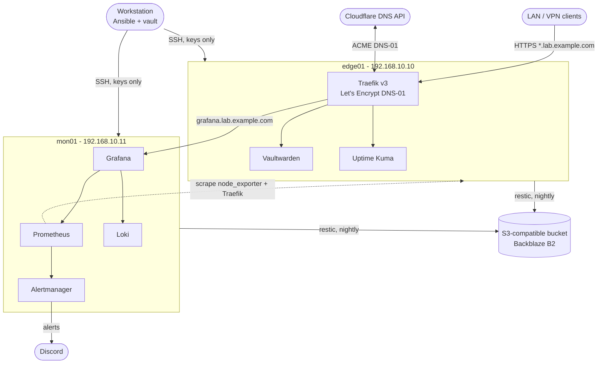

# homelab-iac

[](https://github.com/UserNammy/homelab-iac/actions/workflows/ci.yml)


Infrastructure as code for my homelab: two small Linux VMs, fully rebuilt
from this repository with Ansible. Hardened base OS, Docker, Traefik with
Let's Encrypt, a Prometheus/Grafana/Loki monitoring stack, self-hosted apps,
and encrypted off-site backups with restic with a written restore runbook.

The goal is that losing a VM is boring: create a new one, run one playbook,
restore one restic snapshot.

## Lab overview



More detail, including ports and the reasoning behind each choice, in
[docs/architecture.md](docs/architecture.md).

## Roles

| Role | Applied to | What it does |
|------|------------|--------------|
| [`common`](roles/common) | all hosts | Admin users with SSH keys, SSH hardening via a validated `sshd_config.d` drop-in (no root, no passwords, `AllowGroups`), ufw default-deny, fail2ban (systemd backend, bans through ufw), unattended security upgrades, timezone. Tested with Molecule. |
| [`monitoring`](roles/monitoring) | all hosts | Prometheus `node_exporter` from the official release (checksum verified), sandboxed systemd unit, textfile collector directory, ufw rule limited to the Prometheus server. |
| [`docker`](roles/docker) | `docker_hosts` | Docker Engine and compose plugin from Docker's apt repository (deb822), `daemon.json` with log rotation, `live-restore` and a fixed address pool. |
| [`reverse_proxy`](roles/reverse_proxy) | `proxy` | Traefik v3 in Docker: HTTP to HTTPS redirect, wildcard certificate through DNS-01, `lan-only` and security header middlewares, password-protected dashboard, Prometheus metrics, routes to services on other hosts. Talks to Docker through a read-only socket proxy. |
| [`services`](roles/services) | `docker_hosts` | Copies each stack from [`services/`](services) to `/opt/stacks/<name>`, renders `*.j2` files (secrets end up in `0600` `.env` files) and runs `docker compose up`. Containers are recreated when their config changes. |
| [`backup`](roles/backup) | all hosts | restic to an S3-compatible bucket, nightly systemd timer, pre-backup hooks (consistent SQLite copies), retention policy, weekly `restic check`, optional healthchecks.io ping, and a Prometheus metric for the last successful backup. |

### Service stacks

| Stack | Host | Contents |
|-------|------|----------|
| [`monitoring`](services/monitoring) | mon01 | Prometheus (targets generated from the inventory, alert rules), Alertmanager (Discord), Grafana (provisioned datasources and dashboard), Loki, Grafana Alloy |
| [`uptime-kuma`](services/uptime-kuma) | edge01 | Status page and external checks |
| [`vaultwarden`](services/vaultwarden) | edge01 | Bitwarden-compatible password manager, signups disabled |

## Repository layout

```text
.
├── inventory/
│   ├── hosts.yml              # hosts and groups
│   ├── group_vars/            # all/, docker_hosts, proxy
│   ├── host_vars/             # per-host stacks, firewall rules, backup paths
│   └── vault.example.yml      # template for the encrypted vault
├── roles/                     # common, monitoring, docker, reverse_proxy, services, backup
├── services/                  # docker compose stacks deployed by the services role
├── docs/                      # architecture, disaster recovery runbook
├── site.yml                   # main playbook
├── requirements.yml           # Ansible collections
├── requirements-dev.txt       # lint / test tooling
└── Makefile
```

## Getting started

### Prerequisites

- A Linux or macOS workstation (WSL works) with Python 3.10+.
- One to three Debian 12 or Ubuntu 24.04 hosts reachable over SSH with a
  sudo-capable user and your public key.
- A domain on Cloudflare (or any [lego DNS provider](https://go-acme.github.io/lego/dns/))
  and an S3-compatible bucket for backups.

### 1. Install the tooling

```bash
make deps            # creates .venv, installs ansible-core, ansible-lint, molecule, collections
source .venv/bin/activate
```

### 2. Describe your lab

- `inventory/hosts.yml`: host names and IP addresses.
- `inventory/group_vars/all/main.yml`: domain, LAN range, admin user and SSH key.
- `inventory/host_vars/<host>.yml`: which stacks run where, extra firewall rules.

### 3. Create the vault

Secrets never live in the repository in clear text. Only
`inventory/vault.example.yml` is committed; the real file is git-ignored.

```bash
make vault-init      # copies the example, opens $EDITOR, encrypts the result
make vault-check     # refuses an unencrypted vault file
```

Tip: put the vault password in a file outside the repository and
`export ANSIBLE_VAULT_PASSWORD_FILE=~/.config/homelab/vault_pass`.

### 4. Deploy

```bash
make ping                         # SSH connectivity
make check                        # dry run with diff
make deploy                       # converge everything
make deploy TAGS=services         # one layer only
make deploy LIMIT=mon01           # one host only
```

Keep `reverse_proxy_acme_staging: true` until the staging certificate is
issued, then switch it to `false` to avoid Let's Encrypt rate limits.

### 5. Test

```bash
make lint            # yamllint + ansible-lint (production profile)
make test            # molecule: common role on Debian 12 and Ubuntu 24.04 (needs Docker)
```

CI runs the same steps on every push and pull request
([.github/workflows/ci.yml](.github/workflows/ci.yml)).

## Backups and recovery

Each host backs up to its own restic repository every night. If a backup is
missing for more than 36 hours, Prometheus fires `ResticBackupTooOld`.

The full restore procedure (single file, Vaultwarden, full host rebuild) is
in [docs/disaster-recovery.md](docs/disaster-recovery.md).

## Roadmap

- [ ] Molecule scenarios for `monitoring`, `docker` and `backup`
- [ ] Renovate to open PRs for pinned image tags and collection versions
- [ ] Filter published container ports in the `DOCKER-USER` chain (Docker bypasses ufw)
- [ ] Ship journald and container logs from every host with Alloy, not only mon01
- [ ] WireGuard role for remote access instead of exposing anything
- [ ] SSO in front of the web UIs (Authelia or Authentik)
- [ ] Automated monthly restore test that restores a snapshot into a throwaway VM
- [ ] Provision the VMs themselves with OpenTofu on Proxmox
- [ ] cAdvisor for per-container metrics
- [ ] Pre-commit hooks (yamllint, ansible-lint, vault encryption check)

## License

[MIT](LICENSE)
