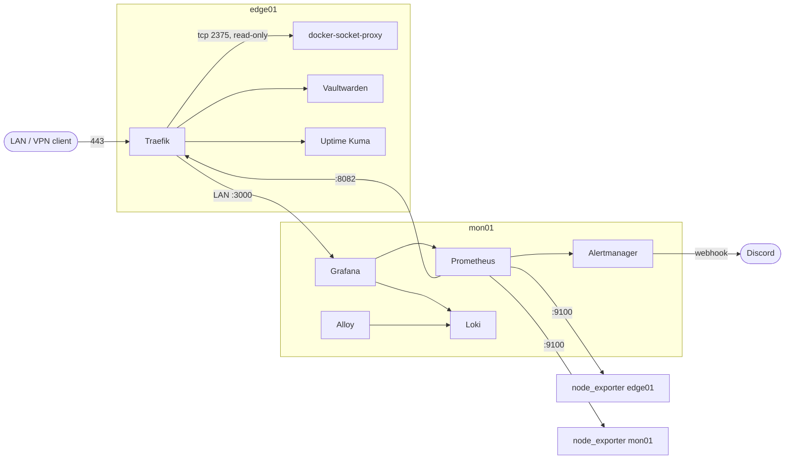

# Architecture

This document explains how the lab is laid out and why. The README covers
how to run things; this is the "what and why".

## Hosts

| Host     | Groups                                  | Role in the lab                                   |
|----------|-----------------------------------------|---------------------------------------------------|
| `edge01` | `homelab`, `docker_hosts`, `proxy`      | Traefik (TLS termination), Vaultwarden, Uptime Kuma |
| `mon01`  | `homelab`, `docker_hosts`, `monitoring_server` | Prometheus, Alertmanager, Grafana, Loki, Alloy |

Both are small Debian 12 or Ubuntu 24.04 VMs (2 vCPU / 2-4 GB RAM is enough).
Adding a third host means adding it to `inventory/hosts.yml` and, if it runs
containers, giving it a `services_stacks` list in `host_vars/`.

## Layers

Every host gets the same base, then features are stacked by group:

```text
site.yml
├── homelab            common  ->  monitoring (node_exporter)
├── docker_hosts       docker
├── proxy              reverse_proxy (Traefik)
├── docker_hosts       services  (compose stacks from services/)
└── homelab            backup (restic)
```

Each play maps to a tag (`--tags common`, `--tags services`, ...) so one layer
can be re-applied without touching the rest.

## Network and traffic flow



| Port  | Host    | Exposed to       | Purpose                              |
|-------|---------|------------------|--------------------------------------|
| 22    | all     | LAN (ufw, rate limited) | SSH, key only                  |
| 80/443| edge01  | LAN              | Traefik (80 only redirects)          |
| 8082  | edge01  | LAN address      | Traefik metrics for Prometheus       |
| 9100  | all     | mon01 + docker pool (ufw) | node_exporter               |
| 3000  | mon01   | LAN address      | Grafana, reached through Traefik     |
| 9090/9093/3100 | mon01 | localhost only | Prometheus, Alertmanager, Loki (use `ssh -L`) |

## Design decisions

**DNS-01 wildcard certificate.** Traefik requests `*.lab.example.com` through
the Cloudflare API. Nothing needs to be port-forwarded from the internet, and
the services stay private while still having trusted certificates. The API
token is scoped to DNS edit on that one zone.

**Docker socket proxy.** Traefik needs to read container labels, but mounting
`/var/run/docker.sock` into an internet-facing process is effectively giving
it root. `docker-socket-proxy` only allows `GET /containers/*` on an internal
network that has no outside access.

**`lan-only` middleware on every router.** Vaultwarden and the dashboards are
never meant to be public. Even if port 443 is forwarded by mistake, requests
from outside the private ranges get a 403. This works because
`userland-proxy` is disabled in `daemon.json`, so Traefik sees real client IPs.

**Configuration as code for Grafana.** Datasources and dashboards are
provisioned from `services/monitoring/grafana/`. The Grafana volume is not
backed up: rebuilding mon01 gives the same Grafana.

**Metrics and logs are disposable.** Prometheus TSDB and Loki chunks live in
named volumes and are not backed up. Losing 30 days of metrics is acceptable
for a homelab; losing the password vault is not.

**Backups report into monitoring.** The restic script writes
`restic_backup_last_success_timestamp_seconds` through the node_exporter
textfile collector. Prometheus alerts if a host has not backed up for 36h.
This catches the silent failure case (expired S3 key, full bucket, broken
timer) that a "backup succeeded" email never would.

**One restic repository per host.** Each host writes to
`s3:.../homelab-restic/<hostname>`. Deduplication across hosts is lost, but
a restore never needs to sort through other hosts' snapshots, and S3 keys can
be scoped per prefix.

**SSH drop-in instead of editing `sshd_config`.** The hardening lives in
`/etc/ssh/sshd_config.d/10-hardening.conf`. sshd keeps the first value it
reads, so the low number wins over `50-cloud-init.conf`, and package upgrades
never conflict with a modified `sshd_config`. The file is validated with
`sshd -t` before it is put in place, and the role refuses to apply
`AllowGroups` if the account Ansible connects with is not managed.

## Known limitations

- **Docker bypasses ufw.** Ports published by Docker are handled in the
  `DOCKER` iptables chain before ufw's rules. ufw rules for 80/443 are kept for
  documentation, but the real exposure is controlled by *where* ports are
  published: `127.0.0.1` for internal tools, the LAN address for Grafana and
  Traefik metrics. Filtering in the `DOCKER-USER` chain is on the roadmap.
- **Single Traefik instance.** If edge01 is down, every web UI is down.
  Acceptable for a lab; Uptime Kuma (also on edge01) would not notice, which
  is why Prometheus on mon01 also alerts on `up == 0`.
- **No log shipping from edge01 yet.** Alloy only runs on mon01.
